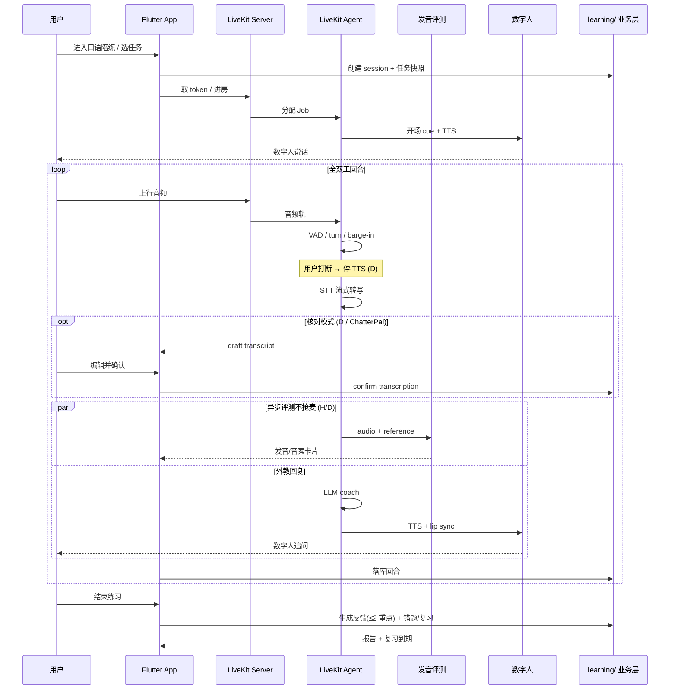
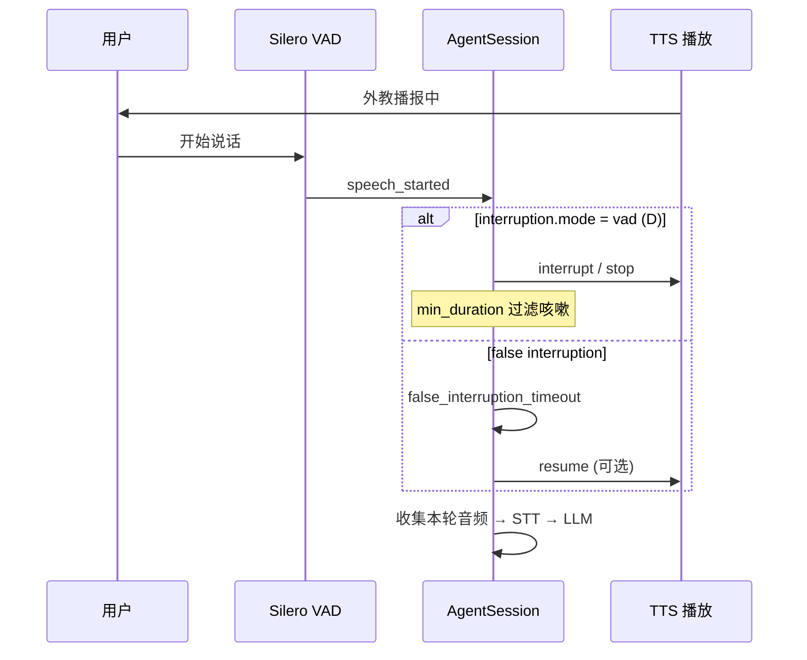
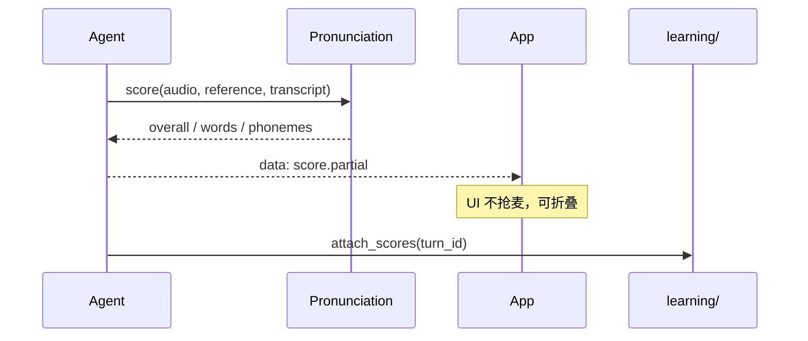
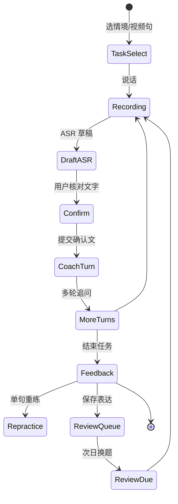
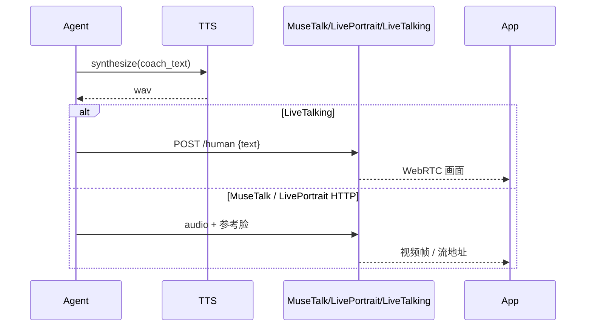

# 交互时序 — 数字人口语外教

> 证据分级：  
> - **假设 (H)**：由公开产品面 + 行业常规推导  
> - **设计 (D)**：AcquireEnglish 目标实现  
> - **观测 (O)**：REA/ADB/mitm 抓包后填写（当前无设备，暂无 O）

## 1. 总览：一次完整练习



## 2. 打断（Barge-in）— LiveKit Agents (D)



配置要点（LiveKit）：

- `TurnHandlingOptions.interruption.mode`: `"vad"` 或 `"adaptive"`
- `min_duration` / `min_words`：抑制误打断
- `resume_false_interruption`: 噪音误打断后恢复播报

## 3. 边聊边评 vs 回合后评（H → 待 O）

| 阶段 | Hi Echo（公开） | 我们的设计 (D) |
|------|-----------------|----------------|
| 用户说话中 | 不打断节奏 | 同左；评测异步 |
| 间隙 | 发音/语法轻量卡片 | DataChannel 推送 `score.partial` |
| 结束任务 | 三维分数 + 建议 | ChatterPal：原话引用 ≤2 + 重练入口 |



## 4. ChatterPal 学习闭环 (D)

对齐 [likebeans/ChatterPal](https://github.com/likebeans/ChatterPal) 的产品语义（MIT）：



关键不变量：

1. **草稿与确认分离**：未确认不进 LLM / 不记成绩  
2. **反馈必须引用用户原话**（校验失败则丢弃该条）  
3. **复习调度**：存档 → ~1 天 → 独立作答成功再 ~3/~7 天  
4. **提示/看答案** 与 **独立作答** 分轨记账  

## 5. 数字人播报 (D)



## 6. 视频语境注入 (D — AcquireEnglish 特有)

```text
App 当前句 current_english + 前后句
        │
        ▼
Agent system prompt / tool context
        │
        ▼
外教围绕「视频里这句话」追问，而不是泛闲聊
```

事件：`session.context.updated`（用户拖进度条换句时刷新）。

## 7. 抓包后应补的观测表（O）

| ID | 问题 | 证据类型 | 状态 |
|----|------|----------|------|
| O1 | Hi Echo 是否 WebRTC？信令域名？ | mitm + pcap | 待设备 |
| O2 | 打断事件在客户端还是服务端判定？ | 日志 / 流量时序 | 待设备 |
| O3 | 评分 API 路径与触发点 | mitm HAR | 待设备 |
| O4 | Midoo 会话创建请求体字段 | mitm | 待设备 |
| O5 | 数字人视频流协议 | REA 网络 / Media | 待设备 |

执行步骤见 [capture-playbook.md](./capture-playbook.md)。
