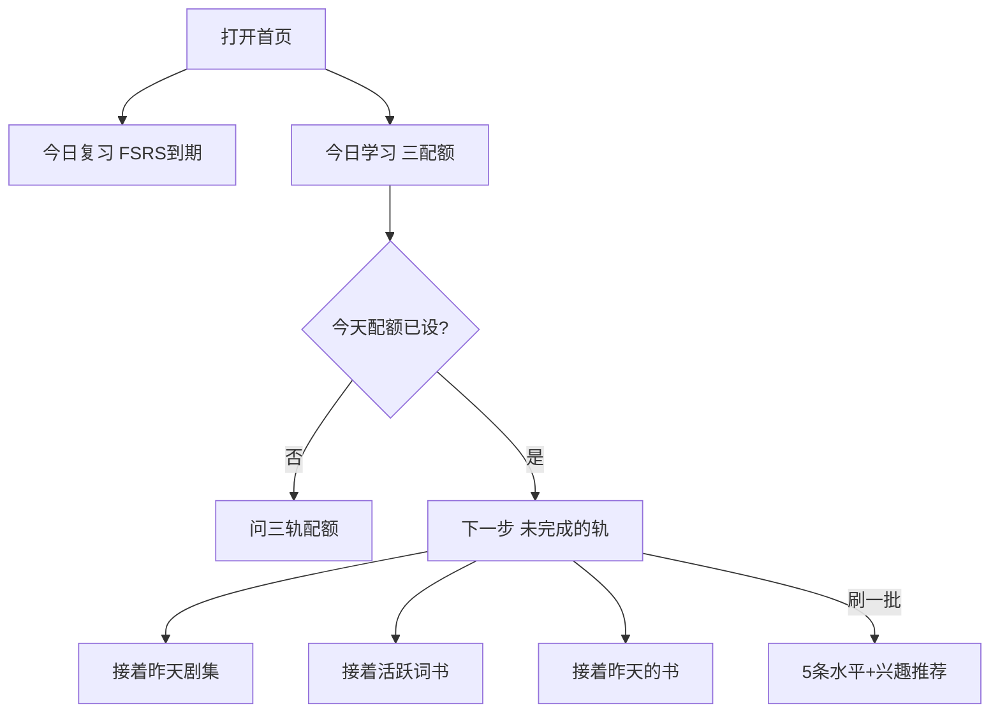

# 今日学习 · 产品需求说明（PRD）

> 状态：2026-11-26 定稿落地 · 「英语之旅」三关仪式 → **今日学习**三配额；「今日课程」→ **今日复习**（FSRS due only）  
> 范围：首页「今日学习」配额续学 + 「今日复习」到期列表；CoursePlan 新课不进复习卡。  
> 相关：`apps/mobile/lib/features/daily_path/`、`.../home/.../today_activity_card.dart`、`docs/COURSE_DECOMPOSE.md`

---

## 0. 设计北极星（2026-11-26 拍板）

**核心目的**：打开 App 先问清楚今天学什么、学多少；点「下一步」总是接着昨天的剧 / 词书 / 小说；下方「今日复习」只放该复习的。

| 原则 | 含义 |
|------|------|
| **三配额可并行** | 视频分钟 / 背词个数 / 阅读词数同时设定；某一轨填 0 = 今天跳过 |
| **连续性 > 算法** | 有在追内容时优先接着昨天；次日复制配额 + 在追目标 |
| **单一主按钮** | 「下一步」按 lastTrack → 视频 → 单词 → 阅读 补齐未完成配额 |
| **复习与新学分离** | 「今日复习」= 统一 FSRS due；新学只走「今日学习」 |
| **刷一批才推荐** | 学完或主动刷一批：最多 5 条视频 + 阅读候选（水平 + 兴趣） |

### 0.1 「下一步」顺序

1. **稍后继续**（`pausedExplicitly`）  
2. **昨天代排**（`planned`）  
3. **未完成配额**：`lastTrack` 优先，其余按 视频 → 单词 → 阅读  
4. **全部达标**：收工 + 「刷一批」

### 0.2 配额预设

| 轨 | 预设 | 进度来源 |
|----|------|----------|
| 视频 | 15 / 20 / 30 分钟 | `learningActivity` 观看 ms |
| 单词 | 10 / 20 / 30 个 | 会话评分（约 25s/词启发式 + store） |
| 阅读 | 300 / 500 / 800 词 | 阅读进度 × 文档词数 |

### 0.3 今日复习（统一 FSRS）

到期计数以 `reviewSourcesProvider` / `reviewPlanForLearnerLevel` 为准，**不用**狭窄的 `wordBookProvider.dueCounts()` 单独当主计数。

卡内只保留：`vocabDue` / `clipDue` / `courseReview`（含逾期）/ `examDue`。  
**不进卡**：`vocabNew`、CoursePlan 新课、`videoWords` / `videoPractice`、继续阅读。

### 0.4 词书 ↔ 认词档

激活 / 切换活跃词书时，用 `examTag` / 书名映射 CEFR，**强写** `LearnerSkill.vocab`（非弱先验）。

---

## 1. 历史：英语之旅三关（已退役）

旧「英语之旅」Gate1 复习 → Gate2 新学 → Gate3 明天，以及「今日课程路径」双系统抢心智的问题，见 git 历史与早期验收清单。  
本文件以 **今日学习 / 今日复习** 为现行北极星；旧 Gate 文案与完成弹窗不再作为产品主路径。

| 旧名 | 新名 | 职责 |
|------|------|------|
| 英语之旅 | **今日学习** | 设配额、进度、「下一步」续学、刷一批 |
| 今日课程 / 今日课程路径 | **今日复习** | 仅 FSRS 到期复习列表 |

---

## 2. 明确不做（本轮）

- 地图主线、强制打卡惩罚、云同步 journey、全国统一课表。  
- 重写整套 CoursePlan；只把它移出「今日复习」主列表。  
- 复杂多目标优化；推荐固定「接着昨天 + 刷 5 条」。

---

## 3. 实现落点

| 模块 | 路径 |
|------|------|
| 今日学习 UI | `apps/mobile/lib/features/home/presentation/widgets/today_activity_card.dart` |
| 配额存储 | `apps/mobile/lib/features/daily_path/data/today_journey_store.dart` |
| 今日复习合成 | `apps/mobile/lib/features/daily_path/presentation/today_path_provider.dart` |
| 复习卡片 | `apps/mobile/lib/features/daily_path/presentation/today_path_card.dart` |
| 词书绑认词档 | `learner_skill_profile` + `syllabus_books_provider` |
| 测试 | `apps/mobile/test/features/daily_path/`、`syllabus_band_align_test.dart` |

---

## 4. 验收口令

打开 App 先问清楚今天学什么、学多少；点下一步总是接着昨天的剧/书/词书；下面「今日复习」只有该复习的。

---

## 5. 修订记录

| 日期 | 说明 |
|------|------|
| 2026-11-26 | 初稿：英语之旅三关 + 今日路径双系统 |
| 2026-11-26 | 北极星改为「无脑下一步」；Gate 排序与反馈拆分 |
| 2026-11-26 | **定稿**：英语之旅 → 今日学习（三配额 + 连续性）；今日课程 → 今日复习（FSRS due only）；旧三关标为历史 |
